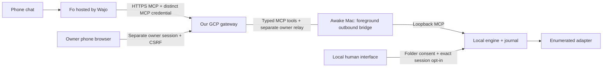
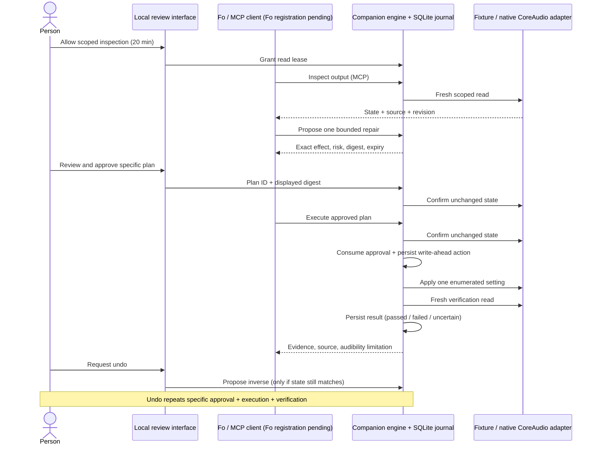

# Repair and deployment boundaries

Fo is Wajo's hosted agent. This repository supplies a separate HTTPS MCP gateway and an outbound Mac companion; Fo does not connect into the Mac. The engine below runs in the local companion, or in an explicitly synthetic cloud fixture. Remote session mode keeps the engine, native adapter, approval enforcement and SQLite journal on the device. The gateway cannot grant inspection or manufacture approval. After explicit local opt-in, it can relay an authenticated owner's exact phone approval to that same device session. See [PHONE-REVIEW.md](PHONE-REVIEW.md).

**Status, 2026-10-19 11:40 IST:** the existing GCP gateway is activated on reviewed source `19b86db0f0bf3f4c5c61bbda942a4c0624400364`; normal-TLS unauthenticated MCP GET/POST return 401. Fo successfully registered the personal bearer/Streamable HTTP connection after an earlier initialize404 failure. Private MCP token entry, Mac connection and all genuine end-to-end runs remain pending. Access and the VM STOP expire at **23:45 IST today**. See [GCP-VM.md](GCP-VM.md) for the deployment snapshot.

The single-owner remote bearer profile pins separate MCP, owner and (when needed) companion credential digests, with one explicit access deadline within 24 hours. Only the owner credential can establish a short-lived Secure HttpOnly browser session; owner mutations need same-origin plus CSRF and never accept a bearer header. MCP cannot approve. Plaintexts are not configured on the server or retained in browser storage. The user generates credentials privately; only digests are handed to deployment. The optional OAuth profile preserves separate audiences/clients/scopes and PKCE, but external-provider/Fo compatibility is unverified and is not a deployment prerequisite.

The default proxy boundary remains loopback. An explicit conventional-host profile permits a `0.0.0.0` private listener and at most 16 exact trusted proxy socket IPs. Forwarded addresses never establish trust; exact Host/Origin and `X-Forwarded-Proto: https` checks remain. There is no wildcard proxy trust.
The session gateway holds one device, at most 3 hours, bounded queues, strict tool schemas and single delivery. Lost delivered execution responses are uncertain and never retried. Offline status does not fabricate hardware. The manually started outbound bridge has no reconnect daemon, command, arbitrary URL or remote folder-grant operation. Its separate owner envelope permits exact review decisions only after local folder consent and opt-in to the current gateway/device/session. Phone review cannot renew either lease. Normal bridge exit revokes delegated review; a hard kill relies on fixed expiry. Ending a gateway session blocks new work; it cannot cancel a native write already started. The Mac must remain awake throughout the take.

Read-only session polling tolerates up to four consecutive transient transport/timeout failures or a prior poll still closing. Backoff is bounded and never exceeds the original session deadline. Authentication rejection, malformed results, local tool execution and result delivery are not retried. After a foreground exit, a manually started launcher may resume the original locally retained gateway receipt with private companion credential entry and a successful authenticated poll. It uses the same session ID and original expiry, never calls connect to replace it, and restores no local folder grant or owner opt-in. There is no automatic session renewal or background reconnect.

The review extension has six strict Mac MCP tools: `review.snapshot`, `review.prepare`, `review.commit`, `review.verify`, `review.undo`, and `review.read_attachment`. The last returns bounded chunks of exact generated PDF/PPTX files only after separate owner sharing approval. A live Fo run proved creation and verification but exposed truncation of 64 KiB base64 results before Fo could reconstruct attachments.

The session gateway also offers `review.attachment_download`: a random, single-use HTTPS capability for one already approved generated file, valid for at most two minutes and the same live Mac session. The download re-reads every chunk through the existing Mac sharing gate, checks the complete file hash and checks access again before sending bytes. It buffers at most two 3 MiB downloads concurrently, stores at most 32 capability hashes in memory, caches no attachment bytes, and logs no capability URLs. Expiry, revocation, session replacement and byte changes cause refusal. A URL does not approve a file, renew access, authorize email/calls or permit arbitrary paths. Deployment access logs must omit these URLs. Fo downloads directly in its own workspace, checks SHA-256 and obtains actual artifact references for its native email tool. Actual delivery and call acceptance remain outstanding. This is not an unattended all-day workflow.

See [DEPLOYMENT.md](DEPLOYMENT.md) for bearer handoff, optional OAuth, explicit TLS proxy boundaries, session lifetime and operational limits. These paths are exercised with synthetic identities/devices and an SDK client; real hosting, identity-provider and Fo acceptance are separate checks.

A read lease never implies write permission. A plan is server-owned; callers cannot supply a command, expected result, arbitrary setting, approval flag, or inverse. The human approval is tied to its plan digest, before-state revision, device source and five-minute deadline. Native reads are asynchronous, so permission and plan status are checked again after the pre-write read. Operations serialize through one engine; a lifetime exclusive SQLite lock prevents two processes from using stale copies of approvals.

Cancellation and lease revocation run immediately rather than waiting in the device-operation queue. A permission generation prevents revoke/regrant from reviving an old read. Pending and approved plans are invalidated when the lease changes, on restart/shutdown, and before any other write starts. This prevents old authorizations from surviving a sequence of internal changes that returns state to its prior values. State hashes canonicalize both device ordering and field ordering.

Before an adapter write, the engine records an executing action and marks approval consumed, then synchronously persists both. A restart marks an unfinished action uncertain, revokes access, invalidates outstanding approvals and never retries a write. Post-write state must match the expected state to pass verification. A failed or unavailable verification is visible and has no automatic undo/retry. Uncertainty requires fresh inspection and a new decision.

Graceful shutdown first refuses new operations and revokes pending authorization, then drains started writes and their verification/journal work before closing HTTP and the database. Revocation during a write does not cancel the already-authorized bounded verification read. Agent status redacts recorded device details without an active lease, while local human history retains the audit trail. The browser observes completed actions from any MCP client and never silently retries a lost write response.

Undo derives its inverse from the stored before state of a verified repair. It refuses if current state no longer matches that repair's after-state revision or the original device/control is unavailable. It creates a new expiring proposal, rather than treating a repair approval as permission to undo later. Undo is not offered for failed/uncertain writes where the verified inverse precondition is absent.

Hash checks detect observed state drift, not a transactional lock across all OS settings. Another application may change a device between the final read and native write; the post-write read detects mismatches at its observation point. This MVP makes no atomic compare-and-swap guarantee for CoreAudio and no claim about physical audibility. Likewise, local history is owner-writable and not a remote audit authority.
